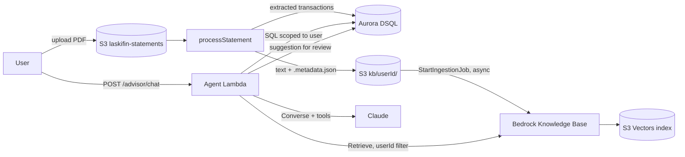

# Decision Record — Data Platform (Aurora DSQL + S3 Vectors + Bedrock Agent)

**Date**: 2026-10-17
**Status**: Direction accepted — implementation not started
**Origin**: Architecture discussion session (outage diagnosis → database cost/benefit → vector layer → agent)

---

## 1. Decisions

| # | Decision | Status |
|---|---|---|
| D1 | Migrate the transactional data from DynamoDB to **Aurora DSQL** now. | Accepted |
| D2 | **Strong consistency inside DSQL** (ACID transactions, foreign keys, `UNIQUE`, `CHECK`). | Accepted |
| D3 | Do **not** use Aurora PostgreSQL Serverless v2 (cost floor, cold resume, connection pitfalls — see §4). | Accepted |
| D4 | Store the text extracted from documents (bank statements, credit-card bills) **per user** in S3 and index it in a **Bedrock Knowledge Base** for semantic retrieval. | Accepted |
| D5 | **Weak / eventual consistency between DSQL and the vector index.** No sync pipeline (no CDC, no Kinesis). The two stores are written independently. | Accepted |
| D6 | Build an **agent** that reads the indexed documents, suggests transactions, and answers questions. Suggestions require user confirmation. | Accepted (design is a proposal — §7) |

### Consistency model

| Boundary | Model | Mechanism |
|---|---|---|
| Within DSQL | Strong | ACID transactions, FKs, `UNIQUE`, `CHECK` constraints |
| DSQL ↔ S3 / Knowledge Base | Weak, no sync | Independent writes. KB ingestion is asynchronous. Vectors are derived data and can be rebuilt from the S3 text at any time. |

---

## 2. Context at decision time (2026-10-17)

- **Only the dev environment exists** (`us-west-2`, account `394379960362`). There are no stacks or Amplify app in `us-west-1` (prod).
- `appfin.kioshitechmuta.link` maps to the Amplify `main` branch of app `d12j7lvonlrr45`, which has **zero deployments**, so it serves the Amplify "Welcome" placeholder. `devfin.kioshitechmuta.link` (branch `dev`) works.
- The Cognito client only allows the `devfin` and `localhost` callback/logout URLs. The `main` branch env vars also point to `devfin`.
- Data volume: Ledger 45 items, MonthlySummary 12, Statements 1, Links 0 (≈17 KB total). DynamoDB cost is $0 (free tier). The whole account costs ≈ US$1/month (Route 53 + Secrets Manager).
- The existing statement pipeline already does LLM extraction: S3 upload → `processStatement` → `pdf-text.ts` (pdfjs) → `llm-parser.ts` (Anthropic API, Zod-validated) → `reconciliation.ts` → review → confirm import.

**Why migrate now**: the data is tiny, prod does not exist yet, and the frontend is partial — this is the cheapest the migration will ever be.

---

## 3. Cost analysis (us-west-2, AWS Pricing API, 2026-10-17)

Monthly estimates for this workload (3 users, near-zero traffic). "Light use" assumes ~2 sessions/day.

| Option | Idle | Light use | Risk / notes |
|---|---|---|---|
| DynamoDB (current) | $0 | $0 | — |
| **Aurora DSQL** | $0 | **$0** (free tier: 100k DPU + 1 GB/month) | $8 per 1M DPU and $0.33/GB-month above the free tier |
| Aurora PG Serverless v2, express config, min 0 ACU (auto-pause) | ≈ $0.10 (storage) | ≈ $1–2 | ≈ **$43.80** if it never pauses (0.5 ACU × 730 h) |
| Aurora PG Serverless v2, min 0.5 ACU | ≈ $43.80 + storage | same | scales with ACU |
| Aurora PG, full VPC config | — | + ≈ $36 networking | NAT Gateway $0.045/h + public IPv4 $0.005/h |
| RDS PostgreSQL `db.t4g.micro` | ≈ $14 | ≈ $14 | + VPC networking |

Unit prices used: Aurora Serverless v2 $0.12/ACU-h (Standard) or $0.16 (I/O-Optimized), storage $0.10/GB-month, I/O $0.20 per 1M. DSQL $0.000008/DPU, $0.33/GB-month. Kinesis on-demand $0.04/stream-hour, provisioned $0.015/shard-hour. Titan Text Embeddings V2 $0.00002 per 1K tokens.

---

## 4. Why DSQL over Aurora PostgreSQL Serverless v2

- **Foreign keys landed in DSQL on 2026-08-26** (`NO ACTION`, `RESTRICT`, `CASCADE`, `SET NULL`, `SET DEFAULT`, deferrable). This removed the main blocker.
- DSQL scales to zero instantly with no resume latency, needs no VPC, and uses IAM auth — it fits Lambdas outside a VPC.
- Aurora Serverless v2 pitfalls for this app:
  - Auto-pause only happens with **no open connections**. The repo's module-scope client pattern would keep connections open, so the cluster would never pause (≈ $44/month).
  - Resume takes up to ~15 s. Nearly every first request of the day would hit it. With the Data API, the first call returns `DatabaseResumingException` and needs a retry.
  - Full VPC configuration forces Lambdas into a VPC → a NAT Gateway (≈ $36/month) is needed for outbound calls (Anthropic API, etc.).
- **Revisit Aurora PostgreSQL only if** triggers, PL/pgSQL, or extensions (e.g. pgvector) become necessary.

---

## 5. DSQL constraints to design around

- No triggers, stored procedures, or extensions.
- Isolation is fixed at Repeatable Read with optimistic concurrency control → handle serialization errors with retries.
- DDL and DML must run in separate transactions; one DDL statement per transaction.
- A transaction can modify at most 3,000 rows and 10 MiB, and can run for at most 5 minutes.
- Connections last at most 1 hour; IAM auth tokens expire after 15 minutes. Use `@aws/aurora-dsql-node-postgres-connector`, which handles token refresh.
- `ALTER COLUMN TYPE`, `DROP COLUMN`, and `DROP CONSTRAINT` require the table-recreation pattern.
- Indexes are created with `CREATE INDEX ASYNC`.
- FK support is recent → validate it in a proof of concept before migrating every domain.

---

## 6. Relational model goals (replacing DynamoDB workarounds)

| Today (manual workaround) | Relational target |
|---|---|
| `MonthlySummary` maintained by hand on every write (`updateMonthlySummary()`) | Removed — monthly totals become an aggregate query or a view, which cannot drift |
| Installments linked by `groupId`, deleted via a partition scan + filter | A purchase table with installments referencing it by FK, `ON DELETE CASCADE`, and `CHECK (installment_number <= installment_total)` |
| Free-text `category` / `source`, normalized with trim/lowercase | Category and account tables with `UNIQUE (user_id, name)` and FKs; a rename happens in one place |
| `categoryMonth` composite attribute + `GSI_MonthlyByCategory` | A regular index on `(user_id, category_id, date)` and a plain query |
| `Links` can leave orphans | FKs on both sides of the link |
| Import dedup via `GSI_LedgerByImportHash` | `UNIQUE (user_id, import_hash)` + FK to the statement |
| Validation only in Zod | `CHECK (amount > 0)`, `CHECK (type IN ('INC','EXP'))` as a second barrier |

### Repo rules affected by the migration

- The mandatory `updateMonthlySummary()` rule (root `CLAUDE.md`, `data-model.md`) becomes obsolete.
- `decodeSk()`, the `TRANS#YYYY-MM#INC|EXP#<uuid>` sort key, and the GSIs go away (resources are addressed by UUID).
- To update: `data-model.md`, `backend-standards.md`, `api-contract.md` (if IDs change), root `CLAUDE.md`, `infra/lib/data-stack.ts`, and the backend tests (DynamoDB mocks).
- The module-scope client rule still applies (DSQL connector pool) — DSQL has no pause penalty.

---

## 7. Vector layer and agent (proposal)



### Indexing

- `processStatement` additionally writes `kb/<userId>/<statementId>.txt` (the extracted text) and `kb/<userId>/<statementId>.txt.metadata.json`:
  ```json
  { "metadataAttributes": { "userId": "<cognito sub>", "bank": "itau", "documentType": "credit-card", "dueDate": "2026-09-10" } }
  ```
- It then triggers `StartIngestionJob`. The document becomes searchable minutes later (accepted — D5).
- Sending pre-extracted text keeps the KB on the free default parser (advanced parsing is billed).
- Deletion: remove the `.txt` and its metadata file from S3, then re-run ingestion.

### Knowledge Base

- **Option A — customer-managed KB + S3 Vectors + Titan Text Embeddings V2** (`amazon.titan-embed-text-v2:0`, on-demand in `us-west-2`):
  - The KB itself is free; you pay for embeddings and S3 Vectors (cents at this volume).
  - The index **must** be created with `nonFilterableMetadataKeys: ["AMAZON_BEDROCK_TEXT"]`. Otherwise chunk text counts against the 2 KB filterable-metadata limit and ingestion fails.
  - Dimension, distance metric, and non-filterable keys are immutable.
  - Vector buckets created after 2026-09-30 use `ENHANCED` index mode (metadata pre-filtering, so filtering by user does not lose recall).
- **Option B — Managed Knowledge Base** (available in `us-west-2`): no vector bucket or index to manage; parser, embeddings, and reranker are included; billed on storage and retrieval calls.

### Isolation

- Every `Retrieve` call carries the filter `userId equals <Cognito sub>`.
- The filter is applied by Lambda code from the authorizer claims — **never** by the model and never from request input.

### Agent

- A Lambda running a **Converse API tool-use loop**. Tools:
  - `search_documents(query, bank?, period?)` → KB `Retrieve`, with `userId` injected by code;
  - `list_transactions(month)` → DSQL, scoped to the user;
  - `suggest_transaction(...)` → writes to a review table in DSQL, never directly to transactions.
- Extracting transactions from a document keeps **full-document** LLM processing (as `processStatement` does today). RAG top-K retrieval would miss lines.
- Numeric questions ("how much did I spend on X this year?") are answered through the SQL tool, not by summing retrieved chunks. Vectors serve context questions ("which bill had the annual fee?").
- Document text is untrusted input → the agent only suggests; the user confirms.
- Do **not** use classic Bedrock Agents (maintenance mode, closed to new customers). AgentCore Harness is a later study option.
- An agent loop can exceed the 29 s default API Gateway REST timeout → plan streaming or async processing.
- This supersedes parts of `ai_chat/ai-advisor-design.md`, which specifies no tool use and no agent loop. That spec needs revision.

---

## 8. Open decisions

1. **KB type**: A (customer-managed + S3 Vectors — more to learn, more control) or B (Managed KB — simpler).
2. **Generation model**: keep the Anthropic API key (`laski/anthropic-api-key`) or move Claude to Bedrock (IAM auth, no external key).
3. **Prod / `appfin`**: quick path (deploy to the `main` branch reusing dev resources + add `appfin` Cognito callbacks) or real prod stacks in `us-west-1`. Recommendation: migrate the data layer before creating prod.
4. **Migration approach**: big-bang cutover is recommended (≈ 58 items).

## 9. Proposed next steps

1. PoC branch: DSQL cluster in CDK, a draft schema with FKs, `listTransactions` rewritten against DSQL, and an AWS Budgets alert.
2. If the PoC holds: migrate the remaining domains, delete the DynamoDB tables, and update the steering files and `CLAUDE.md`.
3. Vector layer: S3 `kb/` prefix + metadata files in `processStatement`, then the KB + data source in CDK.
4. Agent Lambda (`POST /advisor/chat`) with the three tools, and a revision of `ai-advisor-design.md`.
